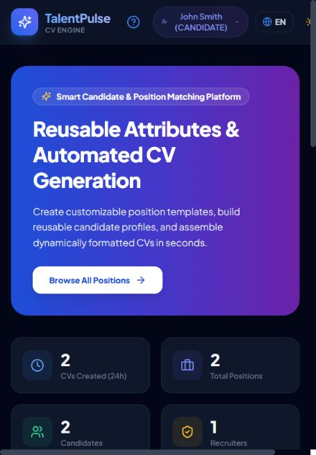

# TalentPulse — управление профилями, позициями и CV

Учебное full-stack приложение для кандидатов, рекрутеров и администратора. Позволяет хранить профиль кандидата, задавать требования позиции и собирать CV из подходящих атрибутов.

[Открыть демо](https://cv-management-system-57ra-dun.vercel.app/)

## Основные функции

- Библиотека типизированных атрибутов и шаблоны позиций.
- Сборка CV по профилю кандидата, проверка обязательных полей и публикация.
- Ролевые кабинеты, обсуждения, поиск и просмотр CV.
- Контроль конфликтов редактирования через версии записей (optimistic locking).
- Печатное представление CV, QR-код, CSV-экспорт, темы и переключение языка.

## Стек и устройство

`frontend/`: React, TypeScript, Vite, Tailwind CSS и React Router.

`backend/`: Node.js, Express, TypeScript, Prisma ORM и **PostgreSQL**. Схема находится в `backend/prisma/schema.prisma`; текущее хранилище не SQLite. Авторизация использует JWT и bcryptjs.

## Статус внешних интеграций

Это подготовленные сценарии, подключение к действующим внешним аккаунтам пока не завершено:

| Сервис | Что реализовано в коде | Что ещё требуется |
| --- | --- | --- |
| Salesforce | Серверный REST-клиент получения токена и создания Account / Contact | Рабочая Salesforce org, параметры приложения и успешная проверка авторизации |
| Odoo | API выдачи агрегированных данных позиции по токену | Экземпляр Odoo, модуль/настройка потребителя и проверка обмена |
| Power Automate | Формирование JSON заявки и код загрузки в Dropbox | Настроенный поток, подключение хранилища и рабочий/учебный Microsoft-аккаунт |

Наличие этих маршрутов не означает работающую синхронизацию с CRM или запущенный Power Automate flow. Ключи задаются только в серверном окружении. Демонстрационные аккаунты и переключение ролей предназначены для учебного показа; реальное развёртывание требует отдельной настройки доступа.

## Локальный запуск

Нужны Node.js/npm и PostgreSQL. Создайте пустую локальную БД и задайте серверные `DATABASE_URL`, `JWT_SECRET` и остальные параметры из обращений к `process.env` в `backend/src/`. Секреты не должны попадать в Git.

```bash
git clone https://github.com/Shuhrat25/cv-management-system.git
cd cv-management-system/backend
npm install
npm run db:push
npm run db:seed
npm run dev
```

`db:seed` используйте только для локальной или отдельной демонстрационной базы. Во втором терминале:

```bash
cd cv-management-system/frontend
npm install
npm run dev
```

Адрес API настраивается в `frontend/src/services/api.ts` / конфигурации окружения. Production-сборка каждого приложения — `npm run build` в соответствующей папке; backend запускается через `npm start` после сборки.

## Демонстрация

В интерфейсе предусмотрено переключение учебных ролей. Данные примеров не являются реальными данными кандидатов. Бесплатный backend Render может запускаться с задержкой после простоя.

## База публичной демонстрации

Демо использует PostgreSQL в Supabase, отдельную схему `talentpulse_demo`. При использовании общего PostgreSQL-проекта задайте `schema=talentpulse_demo` в `DATABASE_URL`; это разделяет таблицы, но не заменяет изоляцию прав отдельных production-приложений. Backend обращается к БД напрямую; Data API Supabase для этой демонстрации не требуется.

На Render: `npm install && npm run build && npm run db:push && node prisma/seed-if-empty.js`. Заполнение примерами включается только `DEMO_SEED=true` и выполняется, если все таблицы приложения пусты. Обычный `db:seed` очищает данные и предназначен только для локального disposable-окружения.


